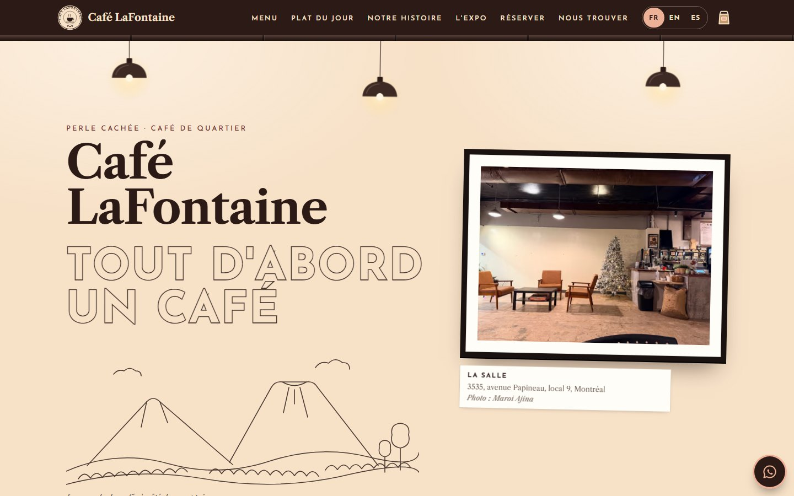
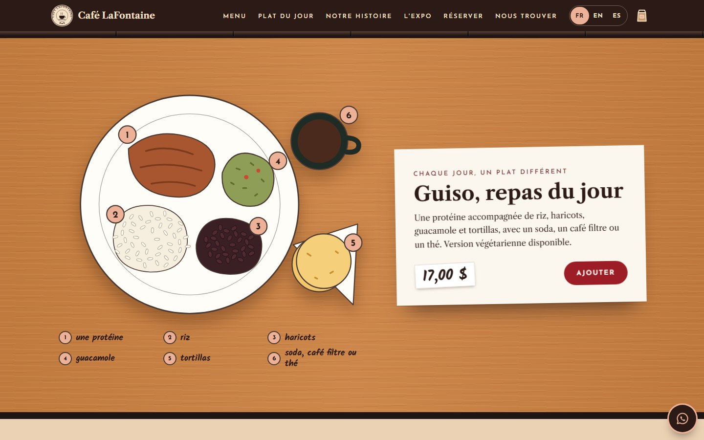
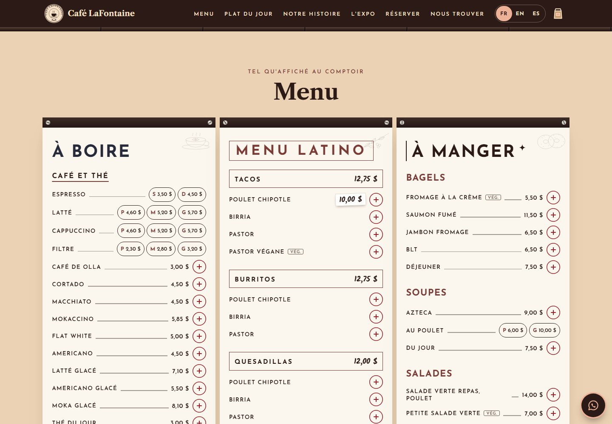
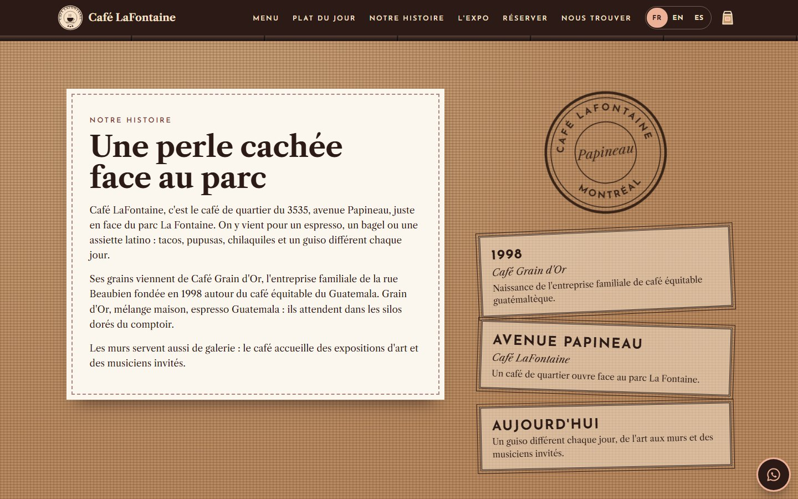
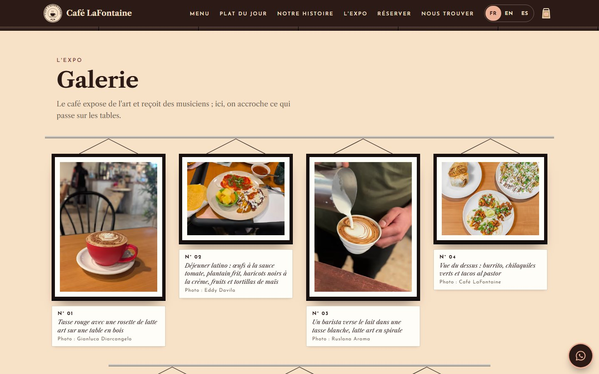
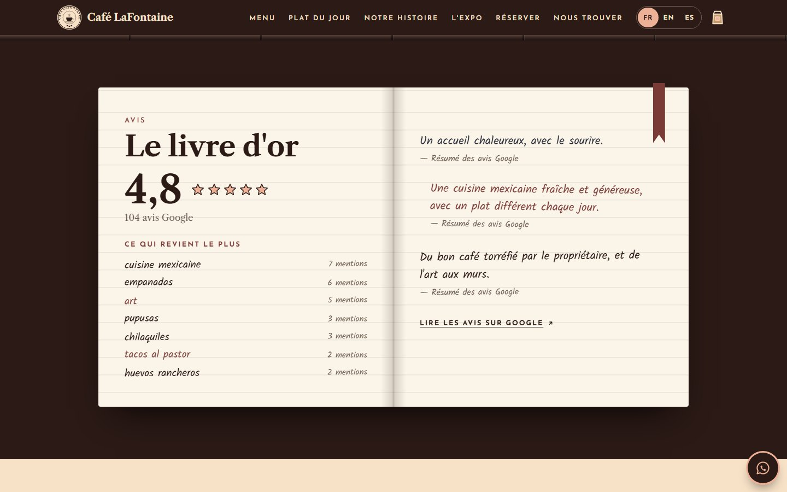
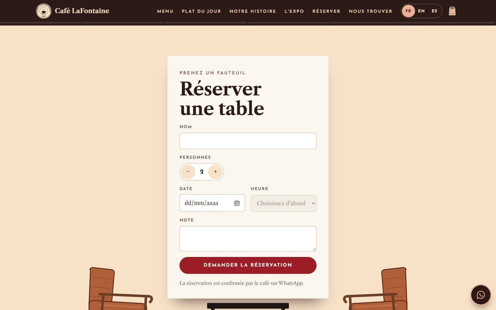
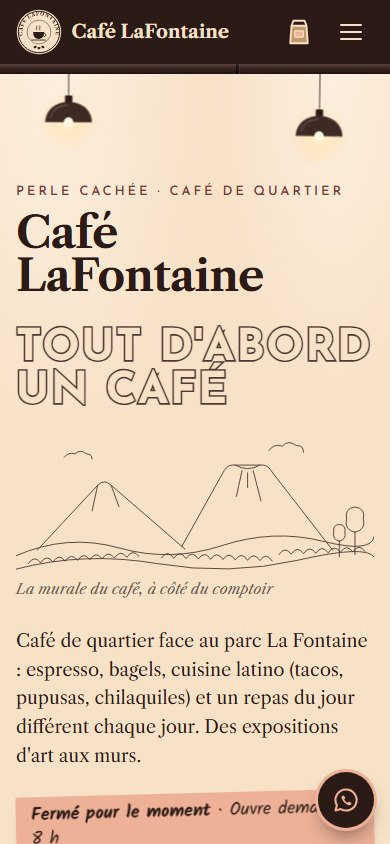
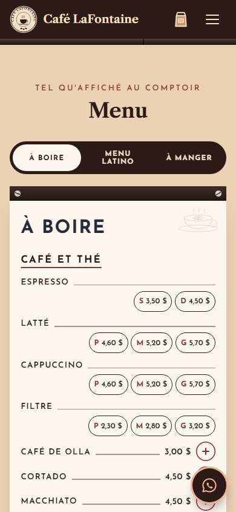
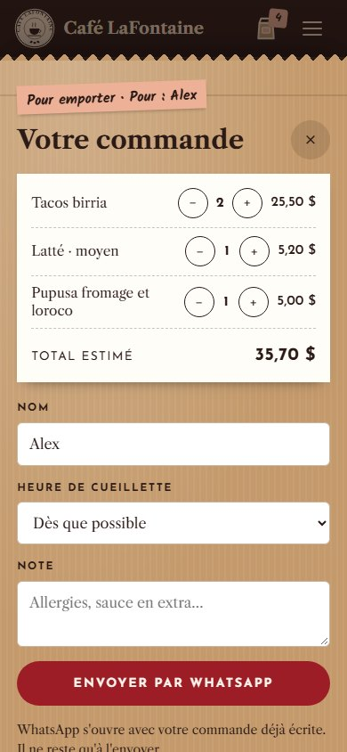

<div align="center">


# Café LaFontaine · Demo website

**Perle cachée · Café de quartier · across from Parc La Fontaine, Montréal.**
Mock-up of Café LaFontaine's website: the counter menu with prices, the guiso of the day, pickup orders and table bookings via WhatsApp, live opening hours and three languages.


[Español](README.md) · **English**

**[User manual](docs/MANUAL.en.md)**: step-by-step tasks (prices, hours, photos, texts) and a developer guide.

</div>

> [!NOTE]
> **Demo mock-up, not Café LaFontaine's official website.** It was built from public information (Google Maps, their Facebook page, local listings) to show the owner. It displays a visible notice and is not indexed by Google (`noindex`). Before going live as the real site, the data marked as pending must be confirmed.



## Overview

|                 |                                                                                                    |
| --------------- | -------------------------------------------------------------------------------------------------- |
| What it is      | Single-page site for Café LaFontaine, 3535 avenue Papineau (unit 9), Montréal                      |
| Tier            | **Premium** (switch to Standard or Basic with one line)                                            |
| Languages       | French (default), English and Spanish, with a switcher                                             |
| Currency        | Canadian dollar (CAD), prices from the counter menu                                                |
| Orders          | Pickup orders and bookings via WhatsApp: no payment gateway, no database, no backend               |
| Design          | Unique to this café: drawn from its photos (the mural, the menu boards, the coffee bins, the armchairs) |
| Tech            | Next.js 15 (App Router), React 19, TypeScript, framer-motion                                       |
| Hosting         | Vercel. Static page, no environment variables                                                      |
| Code            | Commented in **Spanish and English**, saying what can and cannot be touched                       |

## Screenshots

<table>
  <tr>
    <td width="50%"></td>
    <td width="50%"></td>
  </tr>
  <tr>
    <td></td>
    <td></td>
  </tr>
  <tr>
    <td></td>
    <td></td>
  </tr>
</table>

On mobile (390 px): hero, menu with tabs and the order in the kraft bag.

<p align="center">
  
  &nbsp;
  
  &nbsp;
  
</p>

## What each section does

**Header: "le plafond"**

- The café's dark ceiling with its exposed duct. Medallion with the name (like their round logo), links to each section, FR · EN · ES switcher and the kraft order bag with the number of items on a salmon label. On mobile, the links and languages open in a panel.

**Hero: "le mur"**

- The cream back wall of the café with three dome lamps hanging.
- The mural's sentence, **TOUT D'ABORD UN CAFÉ**, in outlined letters like the one on the wall, and below it its line landscape: volcano, hills and coffee rows. On premium, the letters get painted and the landscape draws itself.
- Live status on a salmon label, computed with Montréal time: "Ouvert maintenant · Ferme à 17 h", "Ouvre demain à 8 h".
- The room photo hangs like an artwork, with its label card.

**Au comptoir**

- The counter's coffee bean bins, with their brass front, chrome knob and handwritten labels: *Grain d'Or*, *Mélange maison*, *Espresso Guatemala*.

**Le plat du jour**

- The guiso seen from above on the wood-look laminate table: a protein, rice, beans, guacamole and tortillas, with a handwritten legend. Handwritten price and an **Add** button.

**The menu: "les tableaux"**

- The counter's three white screwed-on boards with their dark strips: **À boire** (night blue), **Menu latino** (maroon, groups in boxes with their shared price: "TACOS $12.75") and **À manger**.
- Prices corrected by hand on the real menu show as a handwritten sticker. Sizes (S · M · L) are buttons.
- Premium: one tab per board on mobile, dish photos as taped polaroids and a **+** button to add to the order.

**Pickup order (WhatsApp)**

- Built in the "kraft bag": items, quantities, estimated total, name (it shows on the bag's label), pickup time (every 15 min until closing, in Montréal time) and a note.
- Sending opens WhatsApp with the message already written. Nothing is charged on the site and no data is stored.

```text
Bonjour Café LaFontaine ! J'aimerais commander pour emporter :

• 2 × Tacos birria — 25,50 $
• 1 × Latté · moyen — 5,20 $
• 1 × Pupusa fromage et loroco — 5,00 $
• 1 × Guiso, repas du jour — 17,00 $

Total estimé : 52,70 $
Nom : Alex
Cueillette : Dès que possible
Note : Sans oignon, svp
```

**Story: "le sac de jute"**

- On the counter's burlap sack: the paragraphs on a sewn paper label, a round stamp with the name and the street, and the milestones as ink stamps (1998 · Café Grain d'Or, Avenue Papineau, Aujourd'hui).

**Gallery: "l'expo"**

- The café exhibits art, so the photos hang as in an exhibition: hanging rail, cord, black frame with a mat and a numbered label card with the description and the author. On mobile, the wall scrolls sideways.

**Reviews: "le livre d'or"**

- An open guestbook: 4.8 rating with stars, the 104 Google reviews, the most mentioned topics and handwritten summaries, signed as a summary (they are not made-up quotes).

**Booking: "prenez un fauteuil"**

- The reservation card on the low black table, between the two cognac leather armchairs. Name, guests, date, time (only that day's slots) and a note; it is sent via WhatsApp and the café confirms it.

**Getting there: "nous trouver"**

- Opening hours on a framed poster: the live status on top, closed days at the bottom, today on a salmon label. Google map (no API key), address, services, directions, call and Facebook buttons, and the Parc La Fontaine fountain drawn in line.

**Languages**

- The whole page switches to French, English or Spanish: texts, days, times (17 h / 5 p.m. / 17:00) and prices (12,75 $ / $12.75). The mural's sentence stays in French (it is an artwork) with its translation underneath. The choice is remembered in the browser.

## Tiers

The same site is sold at three levels. Switch with `gama` in `src/data/cafe.config.ts`; sections that are not included hide themselves.

| Includes                                              | Basic | Standard | Premium |
| ----------------------------------------------------- | :---: | :------: | :-----: |
| Hero, bins, dish of the day, menu, hours, map         |   ✓   |    ✓     |    ✓    |
| Story, gallery and reviews                            |   –   |    ✓     |    ✓    |
| Floating WhatsApp button and scroll animations        |   –   |    ✓     |    ✓    |
| Menu with tabs and photos                             |   –   |    –     |    ✓    |
| Pickup order and table booking via WhatsApp           |   –   |    –     |    ✓    |
| Language switcher, promotions and extra animations    |   –   |    –     |    ✓    |

Premium extra animations: the mural gets painted and drawn, the lamps switch on and sway, the frames swing, the bag jumps when an item is added. Everything respects "reduce motion".

## How to edit the content

Routine maintenance does not touch the design: almost everything lives in **`src/data/cafe.config.ts`**, and every block explains in Spanish and English how to change it and where on the page it shows. Step by step, in the [user manual](docs/MANUAL.en.md).

| I want to change…                        | File                               | Where                                                                   |
| ---------------------------------------- | ---------------------------------- | ----------------------------------------------------------------------- |
| A price or a name                        | `src/data/cafe.config.ts`          | `carta` → `platos` → `precio`, `nombre`                                 |
| Add or remove an item                    | `src/data/cafe.config.ts`          | `carta` → `platos` (copy a block with a new `id`)                       |
| A size (S, M, L)                         | `src/data/cafe.config.ts`          | Consecutive items with the same name and " · " (`Latte · small`)        |
| The dish of the day                      | `src/data/cafe.config.ts`          | The item with `destacado: true` (and its legend in `ajustes/textos.ts` → `PLATO`) |
| Which board a category goes on           | `src/estilo/ajustes/textos.ts`     | `TABLEROS`                                                              |
| Opening hours                            | `src/data/cafe.config.ts`  | `horario.franjas` (0 = Sunday … 6 = Saturday)                           |
| Phone or WhatsApp                        | `src/data/cafe.config.ts`  | `contacto.telefono`, `contacto.whatsapp`                                |
| Address and map                          | `src/data/cafe.config.ts`  | `contacto.direccion`, `ciudad`, `lat`, `lng`                            |
| Rating and number of reviews             | `src/data/cafe.config.ts`  | `resenas`                                                               |
| The story                                | `src/data/cafe.config.ts`  | `historia.parrafos`, `historia.hitos`                                   |
| A photo                                  | `public/img/`              | Replace the file, keeping the same name                                 |
| Bin labels, headings, titles             | `src/estilo/ajustes/textos.ts`     | `SILOS`, `COPY`                                                         |
| A site-wide color                        | `src/estilo/ajustes/colores.css`   | `:root` block (each color says where it shows)                          |
| A section's look                         | `src/estilo/secciones/NN-…/`       | Its `.css` (the `.tsx` holds a sketch of the section)                   |
| The default language                     | `src/data/cafe.config.ts`  | `idiomaBase`                                                            |
| The tier                                 | `src/data/cafe.config.ts`  | `gama`                                                                  |
| Turn bookings off                        | `src/data/cafe.config.ts`  | `funciones: { reserva: false }`                                         |
| Go from demo to the real site            | `src/data/cafe.config.ts`  | `demo: false` and `seo.url` with the domain                             |

Editing rules:

- Keep quotes and commas intact. Multi-language texts look like this: `{ fr: "…", en: "…", es: "…" }`.
- Prices with a decimal point and no symbol: `12.75` shows as $12.75.
- 24-hour times: `"17:00"`. A closed day: delete its line.
- Every item needs a unique `id` with no spaces. An item without `precio` is shown ("Au comptoir") but cannot be ordered.
- When you are done, `npm run build` must finish without errors (or push and Vercel checks it).

## What can and cannot be touched

Every file states its level on its first line, and every code comment is in Spanish (`ES:`) and English (`EN:`).

| Label                            | Meaning                                                                              | Files                                                                                                      |
| -------------------------------- | ------------------------------------------------------------------------------------ | ---------------------------------------------------------------------------------------------------------- |
| `[EDITABLE]`                     | Safe to change: texts, prices, hours, contact, photos, colors                        | `src/data/cafe.config.ts`, `src/estilo/ajustes/textos.ts`, `src/estilo/ajustes/colores.css`, `public/img/`, `public/marca/` |
| `[CON CUIDADO · EDIT WITH CARE]` | Design. Can be changed knowing React and CSS; a mistake breaks the look, not the data | The rest of `src/estilo/` (`ajustes/fuentes.ts`, `comun/`, `secciones/`, `Pagina.tsx`, `estilo.css`)      |
| `[NO TOCAR · DO NOT EDIT]`       | Engine: tiers, languages, hours, cart, WhatsApp, SEO and security                    | `src/motor/`, `src/app/`, `src/estilo/index.ts`, `next.config.js`, `tsconfig.json`, `package.json`          |

## Structure

Every section has its own folder with everything it needs (component, styles and drawings), numbered in the order it appears on the page. Details and a developer guide in the [manual](docs/MANUAL.en.md#part-b--for-developers).

```text
cafe-lafontaine/
├── src/
│   ├── data/
│   │   └── cafe.config.ts       [EDITABLE]     Café data: menu, prices, hours, contact, photos, story
│   ├── estilo/                                 Café LaFontaine skin: this café's own design
│   │   ├── index.ts             [NO TOCAR]     Contract between the skin and the engine
│   │   ├── Pagina.tsx           [CON CUIDADO]  Section order (with the page map)
│   │   ├── estilo.css           [CON CUIDADO]  Index: imports every sheet in order
│   │   ├── ajustes/                            What gets adjusted without touching components
│   │   │   ├── colores.css      [EDITABLE]     The palette, measured on the café's photos
│   │   │   ├── textos.ts        [EDITABLE]     Headings, bin labels, boards and dish of the day (fr/en/es)
│   │   │   └── fuentes.ts       [CON CUIDADO]  Josefin Sans, Libre Caslon Text and Kalam
│   │   ├── comun/               [CON CUIDADO]  Pieces of several sections: base, buttons, labels, forms,
│   │   │                                       motion by tier, photo, add button, medallion
│   │   └── secciones/           [CON CUIDADO]  One folder per section: Component.tsx + styles.css + dibujos.tsx
│   │       ├── 01-cabecera/                    Dark bar "le plafond"
│   │       ├── 02-portada/                     The mural, the lamps and the framed photo
│   │       ├── 03-mostrador/                   The coffee bean bins
│   │       ├── 04-plato-del-dia/               The guiso on the laminate table
│   │       ├── 05-carta/                       The three boards (+ organizar.ts: sizes, shared price)
│   │       ├── 06-historia/                    The burlap sack and its stamps
│   │       ├── 07-galeria/                     The photo exhibition
│   │       ├── 08-opiniones/                   The guestbook
│   │       ├── 09-promos/                      Promotion posters
│   │       ├── 10-reserva/                     The armchairs and the booking card
│   │       ├── 11-visita/                      Hours poster, map and park fountain
│   │       ├── 12-pie/                         Footer
│   │       ├── 13-pedido/                      The kraft order bag
│   │       └── 14-whatsapp/                    Floating WhatsApp button
│   ├── motor/                   [NO TOCAR]     Tiers, languages, hours, cart, WhatsApp, map, SEO
│   └── app/                     [NO TOCAR]     Next.js layout and page
├── public/
│   ├── img/                     [EDITABLE]     Photos (same name = replaced without touching code)
│   └── marca/icono.svg          [EDITABLE]     Browser tab icon
├── docs/
│   ├── MANUAL.md / MANUAL.en.md                User manual (owner and developers)
│   ├── DISEÑO.md                               Style sheet: where every color, font and detail comes from
│   ├── INFO-EXTRAIDA.md                        Source of every fact and pending items with the owner
│   ├── fotos.json                              Origin, size and author of every photo
│   ├── fuentes/                                Photo of the counter menu (June 2025), source of the prices
│   └── capturas/                               Images in this README
├── next.config.js               [NO TOCAR]     Security headers and images
└── package.json                 [NO TOCAR]     Dependencies and scripts
```

## Getting started

Requirements: Node.js 18.18 or later (20 or later recommended).

```bash
git clone https://github.com/alesstron/LaFontaine.git
cd LaFontaine
npm install
npm run dev
```

The site runs at [http://localhost:3000](http://localhost:3000).

| Command             | What it does                 |
| ------------------- | ---------------------------- |
| `npm run dev`       | Development server           |
| `npm run build`     | Production build             |
| `npm run start`     | Serves the build             |
| `npm run typecheck` | Checks the TypeScript types  |

## Deploying to Vercel

1. On [vercel.com](https://vercel.com): **Add New → Project** and import `alesstron/LaFontaine`.
2. Vercel detects Next.js. No environment variables are needed: **Deploy**.
3. Every push to `main` publishes a new version automatically.
4. With the final domain: set `seo.url` in `cafe.config.ts` (link previews when sharing) and, for the real site, `demo: false`.

## Maintenance (every 6 months)

- [ ] Review hours, menu and prices with the café (and the guiso of the day).
- [ ] Update the Google Maps rating and number of reviews.
- [ ] Replace photos if there are new dishes or a new exhibition.
- [ ] `npm outdated` and `npm update` (minor versions) and `npm audit`.
- [ ] `npm run build` without errors and a quick check on mobile.
- [ ] Push to `main`: Vercel publishes on its own.

Major version jumps (for example Next.js 16) are best done with a developer.

## Design

The full style sheet is in [`docs/DISEÑO.md`](docs/DISEÑO.md). The palette was measured on the café's photos and text contrast is checked (WCAG AA).

| Color                                                                                  | Hex       | Where it comes from                 |
| -------------------------------------------------------------------------------------- | --------- | ----------------------------------- |
|  Crème du mur  | `#F7E1C7` | The mural wall                      |
|  Papier        | `#FBF6EE` | The menu boards                     |
|  Plafond       | `#2B1A16` | The dark ceiling and board strips   |
|  Bordeaux      | `#7A3B37` | "MENU LATINO" on the board          |
|  Ardoise       | `#272A38` | "À BOIRE" on the board              |
|  Tasse rouge   | `#9C1D26` | The red cup                         |
|  Cognac        | `#B06038` | The leather armchairs               |
|  Étiquette     | `#EDB197` | The bin labels                      |
|  Table         | `#CA8041` | The laminate tables                 |

Typography: **Josefin Sans** (the spaced capitals of the boards and the mural), **Libre Caslon Text** (the logo's serif) and **Kalam** (the marker on the labels and the hand-corrected prices).

## Quality and security

- **Tested:** no TypeScript errors, production build, no horizontal scroll at 375 px, full order flow (WhatsApp message, name validation, total), booking (slots for the chosen day, Sunday closed), the three tiers and the three languages.
- **Performance:** static page (176 kB initial JavaScript), AVIF/WebP photos with `next/image`, fonts self-hosted on the site's own domain.
- **Accessibility:** visible focus, labelled fields, keyboard tabs, order panel that keeps focus inside and closes with Escape, alt text on photos, checked contrast and "reduce motion" respected.
- **Security:** `Content-Security-Policy`, `Strict-Transport-Security`, `X-Frame-Options: DENY`, `X-Content-Type-Options: nosniff`, `Referrer-Policy` and `Permissions-Policy` headers; form text is sanitized; no API keys, no environment variables and no backend.
- **SEO:** title, description, Open Graph and Google structured data (address, coordinates, hours). The demo is `noindex`.

## Status and pending items with the owner

- [x] Mural, bins, dish of the day, the three boards with real prices, WhatsApp orders and bookings, story, gallery, reviews, map and three languages
- [x] Code commented in Spanish and English
- [ ] Confirm the WhatsApp number (today it is the café's public phone)
- [ ] Review prices (June 2025 menu): chicken chipotle tacos at $10, chicken soup "6/10"
- [ ] Empanadas: mentioned in reviews but not on the menu (no price for now)
- [ ] Confirm the link with Café Grain d'Or and how to tell it; year it opened on Papineau
- [ ] What the "Bon matin" includes
- [ ] The café's own photos (almost all current ones are customer photos from Google Maps)
- [ ] Vector logo, Instagram and email, if any
- [ ] Final domain, `seo.url` and `demo: false`

## Credits and sources

- **Data:** public Google Maps listing (November 2026), Sophie Asmar's photo of the counter menu, the [café's Facebook page](https://www.facebook.com/cafelafontaine/), [Café Grain d'Or](https://cafegraindor.com) and [RestoEnLigne](https://restoenligne.com/en/restaurants/evaluations/cafe-lafontaine). Details in [`docs/INFO-EXTRAIDA.md`](docs/INFO-EXTRAIDA.md).
- **Photos:** customers on Google Maps: Maroi Ajina, Ruslana Arama, Eddy Davila and Gianluca Diarcangelo; the rest are the café's own photos on its listing. Each one carries its credit on its label card.
- **Typefaces:** Josefin Sans, Libre Caslon Text and Kalam (Google Fonts, SIL Open Font License).

## License

Private project. Code © 2026 alesstron. Café LaFontaine's brand, logo, photos and data belong to their owners and authors.
