<div align="center">


# Café LaFontaine · Web demo

**Perle cachée · Café de quartier · face au parc La Fontaine, Montréal.**
Maqueta de la web de Café LaFontaine: el menú del mostrador con precios, el guiso del día, pedidos para llevar por WhatsApp, reservas en línea confirmadas al momento con panel para el café, horario en vivo y tres idiomas.


**Español** · [English](README.en.md)

**[Manual de uso](docs/MANUAL.md)**: tareas paso a paso (precios, horario, fotos, textos) y guía para programadores.

**[Reservas en línea](docs/RESERVAS.md)**: cómo funcionan y cómo publicarlas gratis (Neon + Vercel), paso a paso.

</div>

> [!NOTE]
> **Maqueta de demostración, no es la web oficial de Café LaFontaine.** Se preparó con información pública (Google Maps, su Facebook, guías locales) para enseñársela al dueño. Muestra un aviso visible y no se indexa en Google (`noindex`). Antes de publicarla como web real hay que confirmar los datos marcados como pendientes.

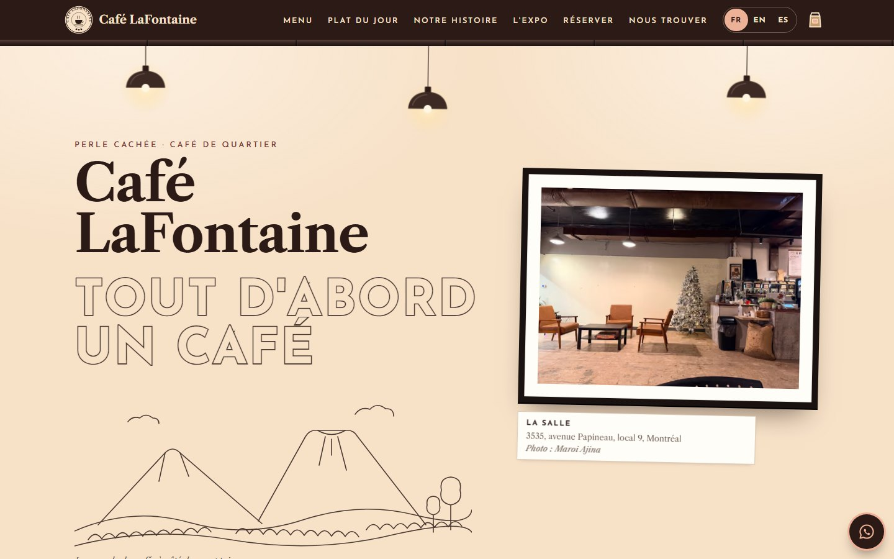

## Resumen

|                 |                                                                                                  |
| --------------- | ------------------------------------------------------------------------------------------------ |
| Qué es          | Web de Café LaFontaine, 3535 avenue Papineau (local 9), Montréal: la página de inicio y las de reserva |
| Gama            | **Premium** (se cambia a Estándar o Básica con una línea)                                        |
| Idiomas         | Francés (por defecto), inglés y español, con selector                                            |
| Moneda          | Dólar canadiense (CAD), precios del menú del mostrador                                           |
| Pedidos         | Para llevar por WhatsApp, sin pasarela de pago                                                   |
| Reservas        | En línea (`/reserver`, pestaña nueva): confirmadas al momento si quedan plazas, guardadas en Postgres y gestionadas en un panel con contraseña |
| Diseño          | Propio de este local: sale de sus fotos (el mural, las pizarras, los silos de café, los sillones) |
| Tecnología      | Next.js 15 (App Router), React 19, TypeScript, framer-motion                                     |
| Alojamiento     | Vercel + base de datos Neon, los dos gratis. Dos variables: `DATABASE_URL` y `RESERVAS_CLAVE`   |
| Código          | Comentado en **español e inglés**, con lo que se puede y no se puede tocar                       |

## Capturas

<table>
  <tr>
    <td width="50%">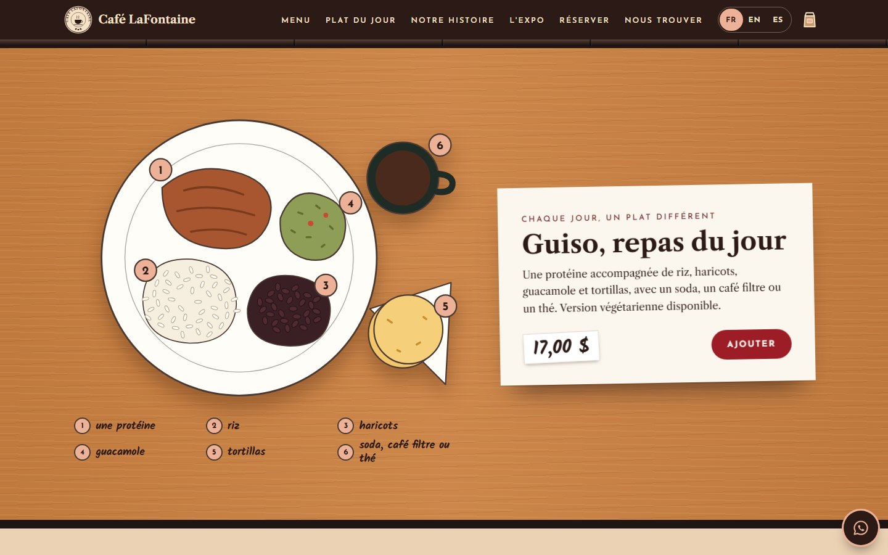</td>
    <td width="50%">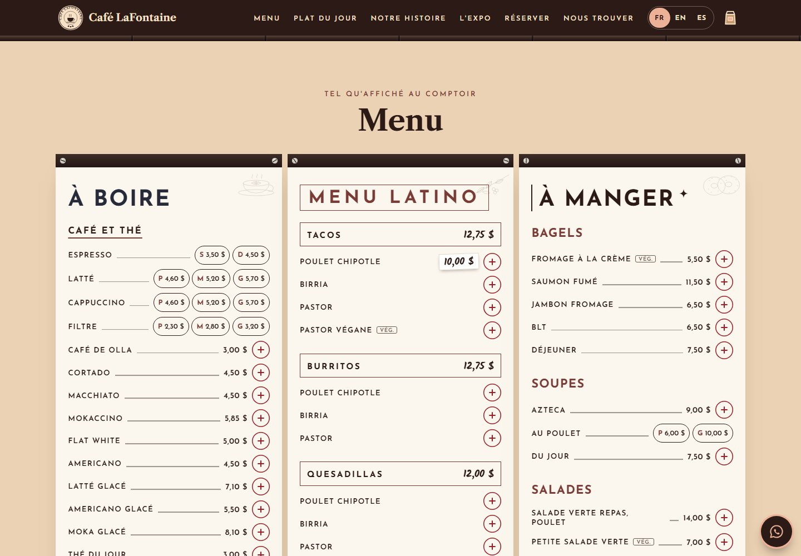</td>
  </tr>
  <tr>
    <td>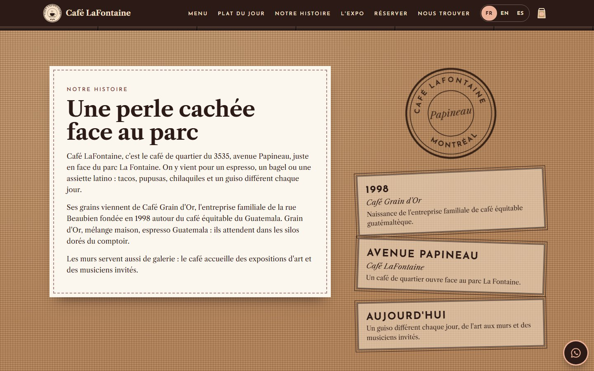</td>
    <td>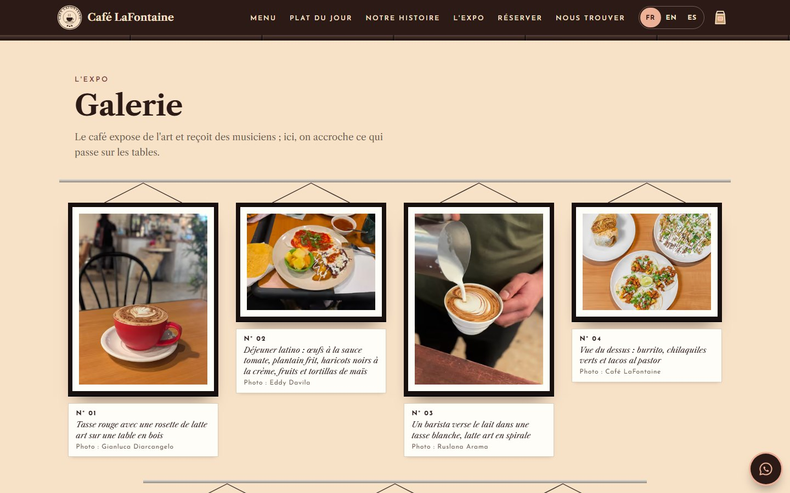</td>
  </tr>
  <tr>
    <td>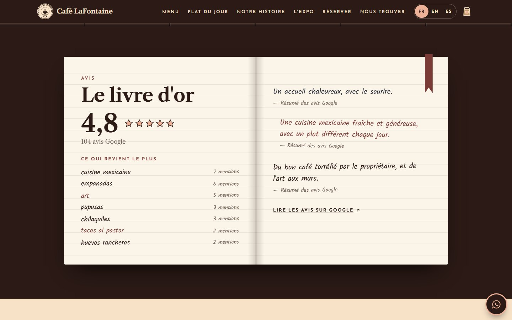</td>
    <td>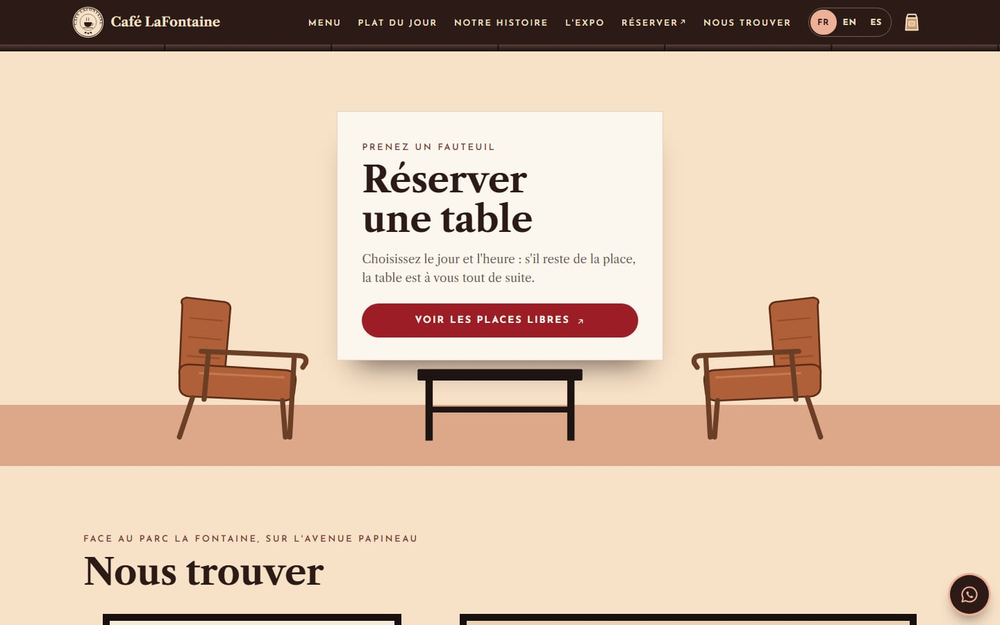</td>
  </tr>
</table>

Reservas en línea (se abren en una pestaña nueva): elegir personas, día y hora; la confirmación «Réservé»; y el panel del café.

<table>
  <tr>
    <td width="50%">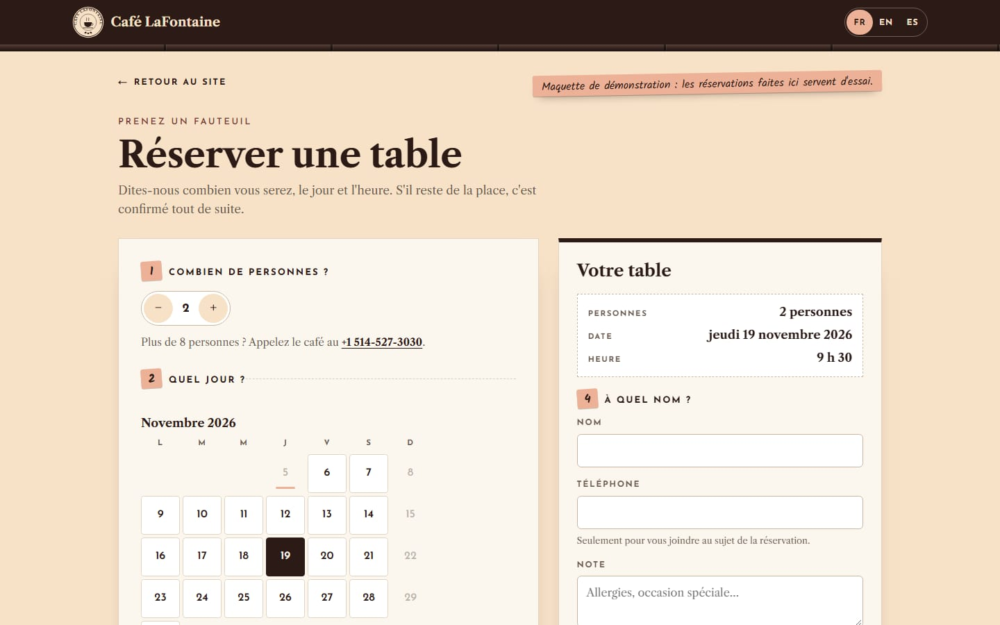</td>
    <td width="50%">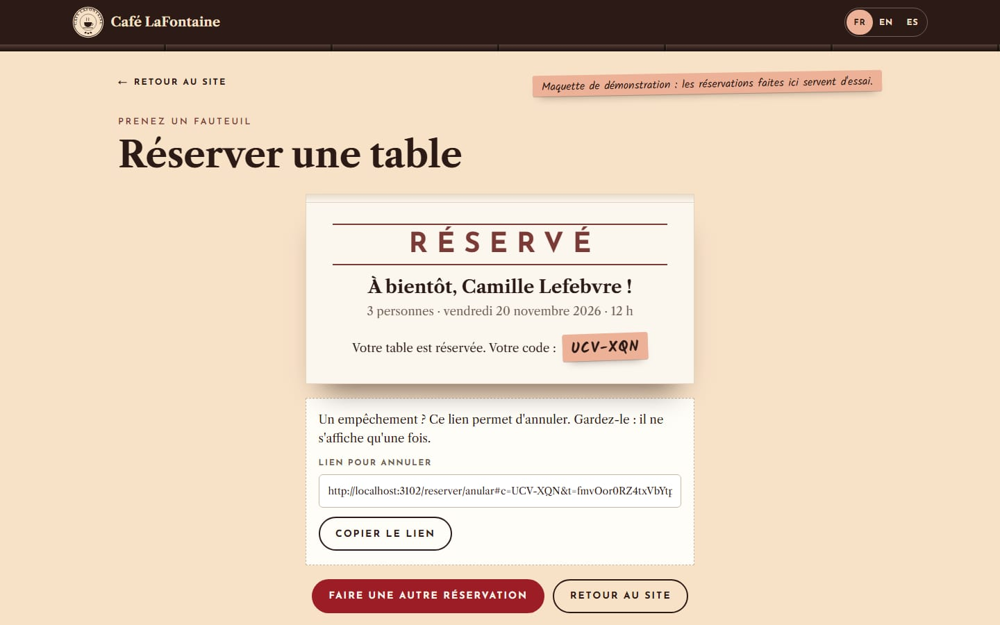</td>
  </tr>
  <tr>
    <td>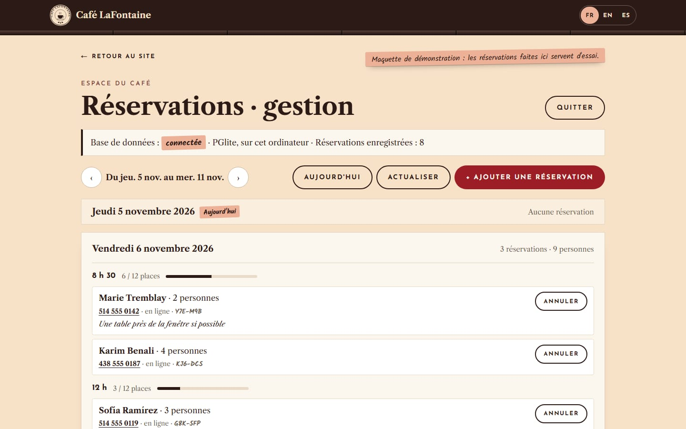</td>
    <td>El <strong>panel del café</strong> (<code>/reserver/gestion</code>, con contraseña): la semana día por día, cada hora con su ocupación, las reservas con teléfono y nota, anular o restaurar, y apuntar las que llegan por teléfono.</td>
  </tr>
</table>

En el móvil (390 px): portada, carta con pestañas y pedido en la bolsa kraft.

<p align="center">
  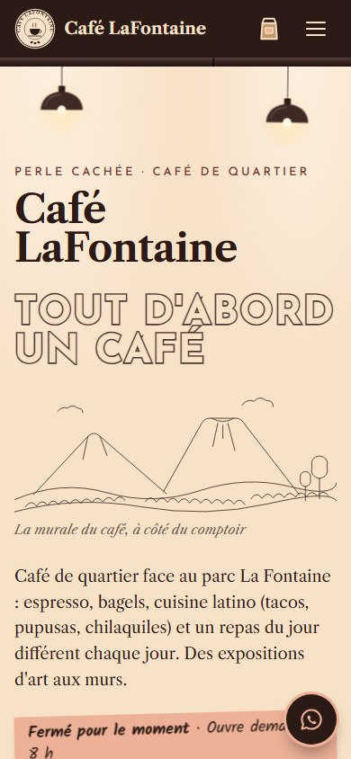
  &nbsp;
  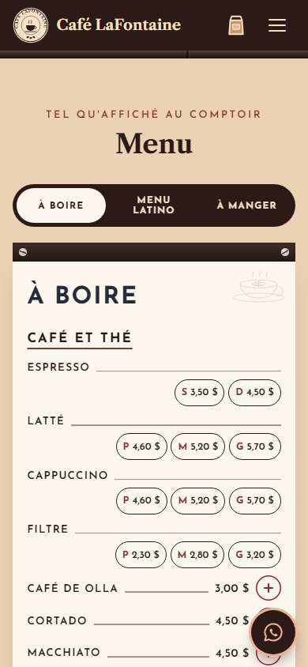
  &nbsp;
  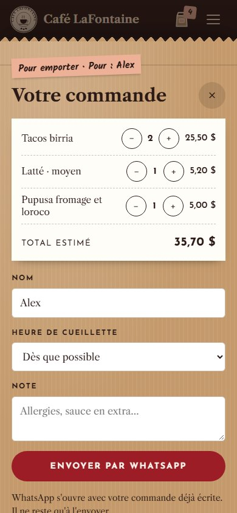
</p>

## Qué hace cada sección

**Cabecera: "le plafond"**

- El techo oscuro del café con su conducto a la vista. Medallón con el nombre (como su logotipo redondo), enlaces a cada sección, selector FR · EN · ES y la bolsa kraft del pedido con el número de artículos en una etiqueta salmón. En el móvil, los enlaces y los idiomas se abren en un panel.

**Portada: "le mur"**

- La pared crema del fondo del café con tres lámparas de campana colgando.
- La frase del mural, **TOUT D'ABORD UN CAFÉ**, en letras huecas como la de la pared, y debajo su paisaje a línea: volcán, colinas y cafetales. En premium, las letras se pintan y el paisaje se dibuja solo.
- Estado en vivo en una etiqueta salmón, calculado con la hora de Montréal: "Ouvert maintenant · Ferme à 17 h", "Ouvre demain à 8 h".
- La foto del salón colgada como una obra, con su cartela.

**Au comptoir**

- Los silos de café en grano del mostrador, con su frente de latón, el pomo cromado y las etiquetas escritas a mano: *Grain d'Or*, *Mélange maison*, *Espresso Guatemala*.

**Le plat du jour**

- El guiso visto desde arriba sobre la mesa de laminado color madera: una proteína, arroz, frijoles, guacamole y tortillas, con leyenda escrita a mano. Precio a mano y botón **Ajouter**.

**La carta: "les tableaux"**

- Las tres pizarras blancas atornilladas del mostrador, con sus listones oscuros: **À boire** (azul noche), **Menu latino** (granate, grupos en cajas con su precio común: "TACOS 12,75 $") y **À manger**.
- Los precios corregidos a mano en el menú real salen como etiqueta escrita a mano. Los tamaños (P · M · G) son botones.
- Premium: pestañas por pizarra en el móvil, fotos de los platos como polaroids sujetas con cinta y botón **+** para añadir al pedido.

**Pedido para llevar (WhatsApp)**

- Se arma en la "bolsa kraft": platos, cantidades, total estimado, nombre (aparece en la etiqueta de la bolsa), hora de recogida (cada 15 min hasta el cierre, en hora de Montréal) y nota.
- Al enviar se abre WhatsApp con el mensaje ya escrito. No se cobra nada en la web y no se guardan datos.

```text
Bonjour Café LaFontaine ! J'aimerais commander pour emporter :

• 2 × Tacos birria — 25,50 $
• 1 × Latté · moyen — 5,20 $
• 1 × Pupusa fromage et loroco — 5,00 $
• 1 × Guiso, repas du jour — 17,00 $

Total estimé : 52,70 $
Nom : Alex
Cueillette : Dès que possible
Note : Sans oignon, svp
```

**Historia: "le sac de jute"**

- Sobre el saco de yute de la barra: los párrafos en una etiqueta de papel cosida, un sello redondo con el nombre y la calle, y los hitos como sellos de tinta (1998 · Café Grain d'Or, Avenue Papineau, Aujourd'hui).

**Galería: "l'expo"**

- El café expone arte, así que las fotos se cuelgan como en una exposición: barra de colgar, cordón, marco negro con paspartú y cartela numerada con la descripción y el autor. En el móvil, la pared se recorre de lado.

**Opiniones: "le livre d'or"**

- Un libro de visitas abierto: nota 4,8 con estrellas, las 104 opiniones de Google, los temas más citados y resúmenes escritos a mano, firmados como resumen (no son citas inventadas).

**Reserva: "prenez un fauteuil"**

- La tarjeta de reserva sobre la mesa baja negra, entre los dos sillones de cuero coñac, con el botón **Voir les places libres**, que abre la página de reserva en una pestaña nueva (igual que «Réserver» en la cabecera y «Réserver une table» en la portada).

**Reservas en línea (páginas nuevas)**

- **`/reserver`**: el rincón de los sillones a tamaño de página. A la izquierda, el carnet de reservas con tres pasos: cuántas personas (hasta 8; los grupos más grandes llaman), qué día (calendario de los próximos 30 días, los domingos y los días llenos apagados) y a qué hora (cada media hora, las llenas tachadas, «plus que 2» cuando quedan pocas). A la derecha, el ticket «Votre table» con el resumen, nombre, teléfono y nota.
- **Confirmación al momento** si quedan plazas: el cartelito «Réservé» con el código (`7KQ-3XA`) y el enlace para anular (no se envían correos).
- **`/reserver/anular`**: con ese enlace, el cliente ve su reserva y la anula; la plaza se libera.
- **`/reserver/gestion`**: el panel del café, con contraseña. Más detalle en [docs/RESERVAS.md](docs/RESERVAS.md).

**Cómo llegar: "nous trouver"**

- Horario en un póster enmarcado: arriba el estado en vivo, abajo los días cerrados, el día de hoy en etiqueta salmón. Mapa de Google (sin API key), dirección, servicios, botones de itinerario, llamada y Facebook, y la fuente del parque La Fontaine dibujada a línea.

**Idiomas**

- Toda la página cambia a francés, inglés o español: textos, días, horas (17 h / 5 p.m. / 17:00) y precios (12,75 $ / $12.75). La frase del mural se queda en francés (es una obra) con su traducción debajo. La elección se recuerda en el navegador.

## Gamas

La misma web se vende en tres niveles. Se cambia con `gama` en `src/data/cafe.config.ts`; las secciones que no entran se ocultan solas.

| Incluye                                             | Básica | Estándar | Premium |
| --------------------------------------------------- | :----: | :------: | :-----: |
| Portada, silos, plato del día, carta, horario, mapa |   ✓    |    ✓     |    ✓    |
| Historia, galería y opiniones                       |   –    |    ✓     |    ✓    |
| Botón flotante de WhatsApp y animaciones al bajar   |   –    |    ✓     |    ✓    |
| Carta con pestañas y fotos                          |   –    |    –     |    ✓    |
| Pedido para llevar (WhatsApp) y reservas en línea   |   –    |    –     |    ✓    |
| Selector de idioma, promociones y animaciones extra |   –    |    –     |    ✓    |

Animaciones extra de premium: el mural se pinta y se dibuja, las lámparas se encienden y se balancean, los cuadros se mecen, la bolsa salta al añadir un plato. Todo respeta "reducir movimiento".

## Cómo editar el contenido

El mantenimiento normal no toca el diseño: casi todo está en **`src/data/cafe.config.ts`**, y cada bloque explica en español e inglés cómo cambiarlo y en qué parte de la página se ve. Paso a paso, en el [manual de uso](docs/MANUAL.md).

| Quiero cambiar…                          | Archivo                            | Dónde                                                                 |
| ---------------------------------------- | ---------------------------------- | --------------------------------------------------------------------- |
| Un precio o un nombre                    | `src/data/cafe.config.ts`          | `carta` → `platos` → `precio`, `nombre`                               |
| Añadir o quitar un plato                 | `src/data/cafe.config.ts`          | `carta` → `platos` (copiar un bloque con un `id` nuevo)               |
| Un tamaño (P, M, G)                      | `src/data/cafe.config.ts`          | Platos seguidos con el mismo nombre y " · " (`Latté · petit`)         |
| El plato del día                         | `src/data/cafe.config.ts`          | El plato con `destacado: true` (y su leyenda en `ajustes/textos.ts` → `PLATO`) |
| En qué pizarra sale una categoría        | `src/estilo/ajustes/textos.ts`     | `TABLEROS`                                                            |
| El horario                               | `src/data/cafe.config.ts`  | `horario.franjas` (0 = domingo … 6 = sábado)                          |
| Teléfono o WhatsApp                      | `src/data/cafe.config.ts`  | `contacto.telefono`, `contacto.whatsapp`                              |
| Dirección y mapa                         | `src/data/cafe.config.ts`  | `contacto.direccion`, `ciudad`, `lat`, `lng`                          |
| Nota y número de opiniones               | `src/data/cafe.config.ts`  | `resenas`                                                             |
| La historia                              | `src/data/cafe.config.ts`  | `historia.parrafos`, `historia.hitos`                                 |
| Una foto                                 | `public/img/`              | Reemplazar el archivo con el mismo nombre                             |
| Etiquetas de los silos, rótulos, títulos | `src/estilo/ajustes/textos.ts`     | `SILOS`, `COPY`                                                       |
| Un color de toda la web                  | `src/estilo/ajustes/colores.css`   | Bloque `:root` (cada color dice dónde se ve)                          |
| El aspecto de una sección                | `src/estilo/secciones/NN-…/`       | Su `.css` (el `.tsx` tiene un boceto de la sección)                   |
| El idioma por defecto                    | `src/data/cafe.config.ts`  | `idiomaBase`                                                          |
| La gama                                  | `src/data/cafe.config.ts`  | `gama`                                                                |
| Plazas, grupo máximo, días de reserva, festivos | `src/data/cafe.config.ts` | `reservas` (`plazasPorTurno`, `maxPersonas`, `diasVista`, `cerrados`) |
| La contraseña del panel de reservas      | Vercel (o `.env.local`)            | Variable `RESERVAS_CLAVE`                                             |
| Quitar las reservas                      | `src/data/cafe.config.ts`  | `funciones: { reserva: false }`                                       |
| Pasar de demo a web real                 | `src/data/cafe.config.ts`  | `demo: false` y `seo.url` con el dominio                              |

Reglas al editar:

- Respeta comillas y comas. Los textos en varios idiomas van así: `{ fr: "…", en: "…", es: "…" }`.
- Precios con punto decimal y sin símbolo: `12.75` se muestra como 12,75 $.
- Horas en formato de 24 h: `"17:00"`. Un día cerrado: borra su línea.
- Cada plato necesita un `id` único sin espacios. Un plato sin `precio` se muestra ("Au comptoir"), pero no se puede pedir.
- Al terminar, `npm run build` debe acabar sin errores (o haz push y Vercel lo comprueba).

## Qué se puede tocar y qué no

Cada archivo dice su nivel en la primera línea, y todos los comentarios del código están en español (`ES:`) y en inglés (`EN:`).

| Etiqueta                         | Significado                                                                            | Archivos                                                                                                   |
| -------------------------------- | -------------------------------------------------------------------------------------- | ---------------------------------------------------------------------------------------------------------- |
| `[EDITABLE]`                     | Se cambia sin miedo: textos, precios, horario, contacto, fotos, colores                | `src/data/cafe.config.ts`, `src/estilo/ajustes/textos.ts`, `src/estilo/ajustes/colores.css`, `public/img/`, `public/marca/` |
| `[CON CUIDADO · EDIT WITH CARE]` | Diseño. Se puede cambiar sabiendo React y CSS; un error rompe el aspecto, no los datos | El resto de `src/estilo/` (`ajustes/fuentes.ts`, `comun/`, `secciones/`, `paginas/`, `Pagina.tsx`, `estilo.css`) |
| `[NO TOCAR · DO NOT EDIT]`       | Motor: gamas, idiomas, horario, carrito, WhatsApp, reservas (servidor y base de datos), SEO y seguridad | `src/motor/`, `src/app/`, `src/estilo/index.ts`, `next.config.js`, `tsconfig.json`, `package.json`          |

## Estructura

Cada sección tiene su carpeta con todo lo suyo (componente, estilos y dibujos), numerada en el orden en que sale en la página. Detalle y guía para programadores en el [manual](docs/MANUAL.md#parte-b--para-programadores).

```text
cafe-lafontaine/
├── src/
│   ├── data/
│   │   └── cafe.config.ts       [EDITABLE]     Datos del café: carta, precios, horario, contacto, fotos, historia
│   ├── estilo/                                 Piel de Café LaFontaine: el diseño propio de este local
│   │   ├── index.ts             [NO TOCAR]     Contrato entre la piel y el motor
│   │   ├── Pagina.tsx           [CON CUIDADO]  Orden de las secciones (con el mapa de la página)
│   │   ├── estilo.css           [CON CUIDADO]  Índice: importa todas las hojas en orden
│   │   ├── ajustes/                            Lo que se ajusta sin tocar componentes
│   │   │   ├── colores.css      [EDITABLE]     La paleta, medida en las fotos del local
│   │   │   ├── textos.ts        [EDITABLE]     Rótulos, etiquetas de los silos, pizarras y plato del día (fr/en/es)
│   │   │   └── fuentes.ts       [CON CUIDADO]  Josefin Sans, Libre Caslon Text y Kalam
│   │   ├── comun/               [CON CUIDADO]  Piezas de varias secciones: base, botones, etiquetas, formularios,
│   │   │                                       animación por gama, foto, botón de añadir, medallón
│   │   ├── secciones/           [CON CUIDADO]  Una carpeta por sección: Componente.tsx + estilos.css + dibujos.tsx
│   │   │   ├── 01-cabecera/                    Barra oscura "le plafond"
│   │   │   ├── 02-portada/                     El mural, las lámparas y la foto enmarcada
│   │   │   ├── 03-mostrador/                   Los silos de café en grano
│   │   │   ├── 04-plato-del-dia/               El guiso sobre la mesa de laminado
│   │   │   ├── 05-carta/                       Las tres pizarras (+ organizar.ts: tamaños, precio común)
│   │   │   ├── 06-historia/                    El saco de yute y sus sellos
│   │   │   ├── 07-galeria/                     La exposición de fotos
│   │   │   ├── 08-opiniones/                   El libro de oro
│   │   │   ├── 09-promos/                      Carteles de promociones
│   │   │   ├── 10-reserva/                     Los sillones y la tarjeta con el botón a /reserver
│   │   │   ├── 11-visita/                      Póster de horario, mapa y fuente del parque
│   │   │   ├── 12-pie/                         Pie de página
│   │   │   ├── 13-pedido/                      La bolsa kraft del pedido
│   │   │   └── 14-whatsapp/                    Botón flotante de WhatsApp
│   │   └── paginas/             [CON CUIDADO]  Páginas de reservas: marco común, reserva/, anular/, gestion/
│   ├── motor/                   [NO TOCAR]     Gamas, idiomas, horario, carrito, WhatsApp, mapa, SEO
│   │   └── reservas/            [NO TOCAR]     Servidor de reservas: base de datos, acciones, panel, seguridad
│   └── app/                     [NO TOCAR]     Layout y páginas de Next.js (/, /reserver, /reserver/anular, /reserver/gestion)
├── public/
│   ├── img/                     [EDITABLE]     Fotos (mismo nombre = se reemplaza sin tocar código)
│   └── marca/icono.svg          [EDITABLE]     Icono de la pestaña
├── docs/
│   ├── MANUAL.md / MANUAL.en.md                Manual de uso (dueño y programadores)
│   ├── RESERVAS.md / RESERVAS.en.md            Reservas en línea: funcionamiento, Neon + Vercel, pruebas, problemas
│   ├── DISEÑO.md                               Ficha de estilo: de dónde sale cada color, letra y detalle
│   ├── INFO-EXTRAIDA.md                        Fuente de cada dato y pendientes con el dueño
│   ├── fotos.json                              Origen, medidas y autor de cada foto
│   ├── fuentes/                                Foto del menú del mostrador (junio de 2025), fuente de los precios
│   └── capturas/                               Imágenes de este README
├── .env.example                 [EDITABLE]     Modelo de las variables de las reservas (sin valores)
├── next.config.js               [NO TOCAR]     Cabeceras de seguridad, imágenes y base local de las reservas
└── package.json                 [NO TOCAR]     Dependencias y comandos
```

## Empezar

Requisitos: Node.js 18.18 o superior (recomendado 20 o más).

```bash
git clone https://github.com/alesstron/LaFontaine.git
cd LaFontaine
npm install
npm run dev
```

La web queda en [http://localhost:3000](http://localhost:3000). Las reservas funcionan en tu ordenador sin cuentas: usan una base local (PGlite) que se instala con `npm install`. Para entrar al panel (`/reserver/gestion`), pon una contraseña en `.env.local` (copia `.env.example`, línea `RESERVAS_CLAVE=`). Detalle en [docs/RESERVAS.md](docs/RESERVAS.md#2-probar-en-tu-ordenador-sin-cuentas).

| Comando             | Qué hace                          |
| ------------------- | --------------------------------- |
| `npm run dev`       | Servidor de desarrollo            |
| `npm run build`     | Compilación de producción         |
| `npm run start`     | Sirve la compilación              |
| `npm run typecheck` | Comprueba los tipos de TypeScript |

## Despliegue en Vercel

1. Crea la base de datos gratis en [neon.tech](https://neon.tech) (cuenta propia con GitHub, región AWS US East) y copia su dirección `postgresql://…` (**Connect**, conexión «pooled»).
2. En [vercel.com/new](https://vercel.com/new): importa `alesstron/LaFontaine` y añade dos variables de entorno:
   - `DATABASE_URL`: la dirección de Neon.
   - `RESERVAS_CLAVE`: la contraseña del panel del café (12 caracteres o más).
3. **Deploy**. Las tablas se crean solas. Comprueba en `/reserver/gestion` que dice «Base de données : connectée · Neon».
4. Cada push a `main` publica una versión nueva sola.
5. Con el dominio definitivo: poner `seo.url` en `cafe.config.ts` (vistas previas al compartir el enlace) y, para la web real, `demo: false`.

Guía clic a clic, lista de pruebas y problemas frecuentes: [docs/RESERVAS.md](docs/RESERVAS.md#3-publicar-en-vercel-con-neon-paso-a-paso). Vercel Hobby es gratis pero solo para uso no comercial: para la web real del café, plan Pro u otro alojamiento.

## Mantenimiento (cada 6 meses)

- [ ] Revisar con el local horario, menú y precios (y el guiso del día).
- [ ] Actualizar la nota y el número de opiniones de Google Maps.
- [ ] Cambiar fotos si hay platos nuevos o una exposición nueva.
- [ ] Revisar las plazas por turno y añadir los festivos a `reservas.cerrados`.
- [ ] `npm outdated` y `npm update` (versiones menores) y `npm audit`.
- [ ] `npm run build` sin errores y revisión rápida en el móvil.
- [ ] Push a `main`: Vercel publica solo.

Los saltos de versión mayor (por ejemplo Next.js 16) conviene hacerlos con un desarrollador.

## Diseño

La ficha completa está en [`docs/DISEÑO.md`](docs/DISEÑO.md). La paleta se midió en las fotos del local y el contraste del texto está comprobado (WCAG AA).

| Color                                                                                  | Hex       | De dónde sale                       |
| -------------------------------------------------------------------------------------- | --------- | ----------------------------------- |
|  Crème du mur  | `#F7E1C7` | La pared del mural                  |
|  Papier        | `#FBF6EE` | Las pizarras del menú               |
|  Plafond       | `#2B1A16` | El techo oscuro y los listones      |
|  Bordeaux      | `#7A3B37` | "MENU LATINO" en la pizarra         |
|  Ardoise       | `#272A38` | "À BOIRE" en la pizarra             |
|  Tasse rouge   | `#9C1D26` | La taza roja                        |
|  Cognac        | `#B06038` | Los sillones de cuero               |
|  Étiquette     | `#EDB197` | Las etiquetas de los silos          |
|  Table         | `#CA8041` | Las mesas de laminado               |

Tipografía: **Josefin Sans** (las mayúsculas espaciadas de las pizarras y del mural), **Libre Caslon Text** (el serif del logotipo) y **Kalam** (el rotulador de las etiquetas y de los precios corregidos a mano).

## Calidad y seguridad

- **Probado:** TypeScript sin errores, compilación de producción, 360 y 375 px sin scroll horizontal, pedido completo (mensaje de WhatsApp, validación del nombre, total), las tres gamas y los tres idiomas.
- **Reservas probadas** (base local y compilación de producción): reserva completa, plazas (8 + 4 llenan un turno de 12; 20 reservas simultáneas → entran exactamente 12), validación en el servidor (fecha pasada, domingo, hora inexistente, demasiadas personas, campos vacíos, campo trampa), límites por conexión y por teléfono, anular con el enlace, panel (contraseña mala con pausa, bloqueo tras 5 fallos, anular, restaurar, reserva por teléfono, forzar, salir) y el aviso cuando falta la base de datos en Vercel.
- **Rendimiento:** inicio, `/reserver` y `/reserver/anular` estáticas (190 kB de JavaScript inicial); el panel, dinámico. Fotos en AVIF/WebP con `next/image`, fuentes alojadas en el propio dominio.
- **Accesibilidad:** foco visible, etiquetas en los campos, pestañas con teclado, panel del pedido con el foco dentro y Escape para cerrar, texto alternativo en las fotos, contraste comprobado y respeto de "reducir movimiento".
- **Seguridad:** cabeceras `Content-Security-Policy`, `Strict-Transport-Security`, `X-Frame-Options: DENY`, `X-Content-Type-Options: nosniff`, `Referrer-Policy` y `Permissions-Policy`; el texto de los formularios se sanea. Reservas: todo se valida otra vez en el servidor; panel con cookie firmada `HttpOnly` y `SameSite=Strict`, contraseña comparada en tiempo constante y bloqueo tras 5 fallos; la IP no se guarda (solo una huella que cambia cada día); las reservas se borran solas 30 días después de su fecha; el panel y la página de anular llevan `noindex`.
- **SEO:** título, descripción, Open Graph y datos estructurados de Google (dirección, coordenadas, horario). La demo lleva `noindex`.

## Estado y pendientes con el dueño

- [x] Mural, silos, plato del día, las tres pizarras con precios reales, pedido por WhatsApp, reservas en línea, historia, galería, opiniones, mapa y tres idiomas
- [x] Código comentado en español e inglés
- [x] Reservas en línea con base de datos y panel, listas para publicar en Vercel + Neon ([guía](docs/RESERVAS.md))
- [ ] Confirmar con el dueño las plazas por media hora (hoy 12, estimadas por las fotos), el grupo máximo y la antelación
- [ ] Ley 25 de Quebec: política de privacidad publicada y persona responsable de los datos antes de usar las reservas con clientes reales
- [ ] Confirmar el número de WhatsApp (hoy es el teléfono público del local)
- [ ] Revisar los precios (menú de junio de 2025): tacos poulet chipotle a 10 $, soupe au poulet "6/10"
- [ ] Empanadas: salen en las opiniones pero no en el menú (hoy sin precio)
- [ ] Confirmar la relación con Café Grain d'Or y cómo contarla; año de apertura en Papineau
- [ ] Qué lleva el "Bon matin"
- [ ] Fotos propias del local (casi todas las actuales son de clientes en Google Maps)
- [ ] Logotipo en vectorial, Instagram y correo, si los tiene
- [ ] Dominio definitivo, `seo.url` y `demo: false`

## Créditos y fuentes

- **Datos:** ficha pública de Google Maps (noviembre de 2026), la foto del menú del mostrador de Sophie Asmar, el [Facebook del café](https://www.facebook.com/cafelafontaine/), [Café Grain d'Or](https://cafegraindor.com) y [RestoEnLigne](https://restoenligne.com/en/restaurants/evaluations/cafe-lafontaine). Detalle en [`docs/INFO-EXTRAIDA.md`](docs/INFO-EXTRAIDA.md).
- **Fotos:** clientes en Google Maps: Maroi Ajina, Ruslana Arama, Eddy Davila y Gianluca Diarcangelo; el resto, fotos del propio café en su ficha. Cada una lleva su crédito en la cartela.
- **Tipografías:** Josefin Sans, Libre Caslon Text y Kalam (Google Fonts, licencia SIL Open Font License).

## Licencia

Proyecto privado. Código © 2026 alesstron. La marca, el logotipo, las fotos y los datos de Café LaFontaine pertenecen a sus dueños y autores.
